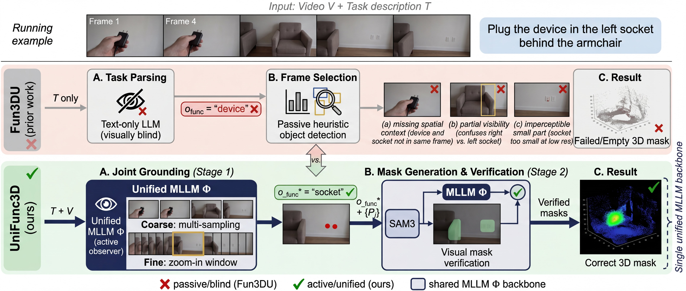
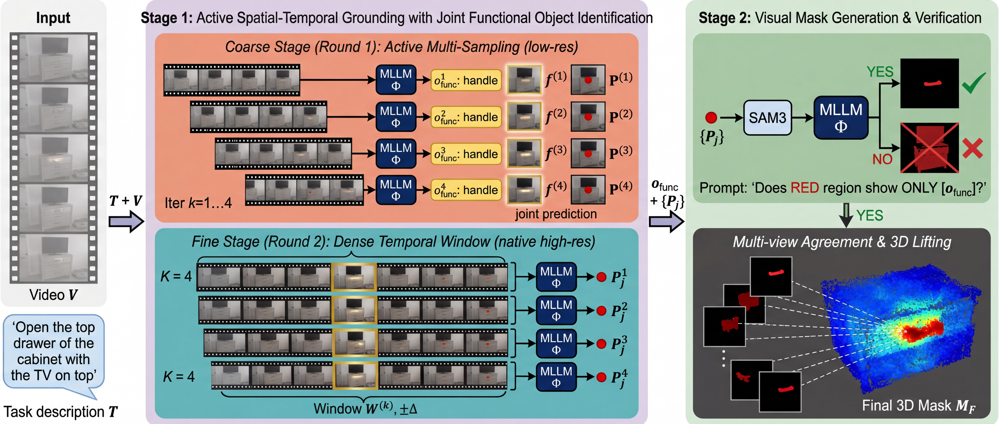

# UniFunc3D: Unified Active Spatial-Temporal Grounding for 3D Affordance Segmentation

**NeurIPS 2026**

[Jiaying Lin](https://jiaying.link/), [Dan Xu](https://www.danxurgb.net/)  
The Hong Kong University of Science and Technology (HKUST)

[Project Page](https://jiaying.link/unifunc3d/) | [Paper](https://arxiv.org/abs/2603.23478)

> **Initial release:** Final predictions and evaluation code are available. **The full code will be released before NeurIPS 2026 starts.**



## Overview

UniFunc3D is a training-free framework for grounding natural-language tasks into fine-grained 3D affordance masks. A unified multimodal large language model jointly reasons about task semantics, video frames, and spatial context. Coarse-to-fine active spatial-temporal grounding selects informative views and localizes interactive parts, followed by SAM3 mask generation, visual verification, and multi-view 3D lifting.



## Results on SceneFun3D

All values are percentages. Split0 is the validation split (30 scenes, 445 descriptions); split1 is the train split (200 scenes, 2,598 descriptions). Both are used only for evaluation, without task-specific training or fine-tuning.

| Method | Split | AP50 | AP25 | AR50 | AR25 | mIoU |
|---|---|---:|---:|---:|---:|---:|
| UniFunc3D-8B | split0 | 23.82 | 44.04 | 46.07 | 55.51 | 20.92 |
| UniFunc3D-30B | split0 | **31.24** | **51.01** | **46.97** | **58.88** | **24.30** |
| UniFunc3D-8B | split1 | 16.24 | 29.02 | 38.91 | 48.15 | 14.23 |
| UniFunc3D-30B | split1 | **21.32** | **35.76** | **40.03** | **51.00** | **17.09** |

## Released predictions

This release includes 6,086 predictions in 460 per-scene JSON files:

| Experiment | Method | Dataset split | Directory |
|---|---|---|---|
| `8b_val` | UniFunc3D-8B | split0 / val | [predictions/8b_val](predictions/8b_val/) |
| `30b_val` | UniFunc3D-30B | split0 / val | [predictions/30b_val](predictions/30b_val/) |
| `8b_train` | UniFunc3D-8B | split1 / train | [predictions/8b_train](predictions/8b_train/) |
| `30b_train` | UniFunc3D-30B | split1 / train | [predictions/30b_train](predictions/30b_train/) |

Each `<visit_id>.json` contains a list of description IDs and predicted point indices:

```json
[{"desc_id": "description-uuid", "pred_mask": [12, 45, 81]}]
```

Indices are sorted, unique, zero-based positions in the **cropped laser scan**, preserving the original PLY vertex order after applying `crop_mask == 1`. Apply predictions before any point reordering or downsampling. An empty list is a valid empty prediction. The released masks have already been thresholded at normalized lifting scores strictly greater than 0.7.

## Evaluation

Evaluation runs on CPU and requires only NumPy; model weights are not needed.

```bash
python -m pip install -r requirements.txt
python verify_release.py
python evaluate.py --dataset-root /path/to/scenefun3d \
  --experiment all --check-reference --output outputs/evaluation.json
```

Use `--experiment 8b_val`, `30b_val`, `8b_train`, or `30b_train` to evaluate one experiment. `verify_release.py` checks file hashes, prediction coverage, and index bounds without requiring the dataset. `--check-reference` compares every query with the bundled reference metrics and checks the reported result table.

Obtain SceneFun3D from the [official toolkit and documentation](https://scenefun3d.github.io/documentation/). The evaluator expects:

```text
scenefun3d/
  benchmark_file_lists/
    val_set.csv
    train_set.csv
  val/<visit_id>/
    <visit_id>_crop_mask.npy
    <visit_id>_annotations.json
    <visit_id>_descriptions.json
  train/<visit_id>/
    <visit_id>_crop_mask.npy
    <visit_id>_annotations.json
    <visit_id>_descriptions.json
```

The split CSVs are bundled in [datasets/benchmark_file_lists](datasets/benchmark_file_lists/); copy them into the dataset directory if needed. Raw scans, RGB/depth frames, and ground-truth assets are not redistributed. Dataset fingerprints are checked against `datasets/{val,train}.json` to ensure point alignment and annotation consistency.

**Metric convention.** We follow the historical Fun3DU point precision/recall threshold protocol. AP25/AP50 indicate whether point precision reaches 0.25/0.50; AR25/AR50 use point recall. mAP/mAR average these indicators over thresholds 0.50, 0.55, ..., 0.95. mIoU is point intersection over union. All metrics are averaged over descriptions; empty predictions have zero precision. These AP values are not instance-detection AP. Ground-truth masks union the existing non-`exclude` annotations referenced by each description, then apply the crop mask.

Evaluation regression checks can be run with `python -m unittest discover -s tests -v`. After intentional file edits, regenerate hashes with `python tools/update_checksums.py` before running `python verify_release.py`.

## Citation

```bibtex
@inproceedings{lin2026unifunc3d,
  title     = {UniFunc3D: Unified Active Spatial-Temporal Grounding for 3D Affordance Segmentation},
  author    = {Lin, Jiaying and Xu, Dan},
  booktitle = {Advances in Neural Information Processing Systems},
  year      = {2026}
}
```

## Acknowledgements

We thank [Fun3DU](https://github.com/tev-fbk/fun3du), [SceneFun3D](https://github.com/SceneFun3D/scenefun3d), [Qwen3](https://github.com/QwenLM/Qwen3), and [SAM3](https://github.com/facebookresearch/sam3). See [THIRD_PARTY_NOTICES.md](THIRD_PARTY_NOTICES.md) for attribution and upstream terms.
